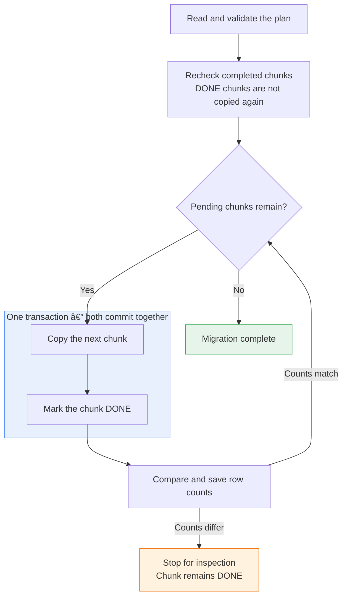

# Redshift chunked deep copy

Deep-copy an unsorted Redshift table into an empty replacement with your chosen
sort and distribution keys. The framework copies timestamp chunks and checkpoints
progress so an interrupted migration can resume without repeating completed work.

## Why I built this

At work, I needed to rebuild fact tables that were 100% unsorted, some exceeding
10 TB, with distribution and sort keys that no longer suited common joins and
filters. Deep copy sorted the data while rebuilding with new keys, and was a
better fit than `VACUUM` for such a large unsorted region.
See [AWS: Performing a deep copy](https://docs.aws.amazon.com/redshift/latest/dg/performing-a-deep-copy.html).

Chunking made interruptions manageable, completed work could be kept and the
remaining chunks resumed. YAML made the process reusable across tables.
This repository is an anonymised reconstruction with a runnable demo.

## Migrate a table

Requires Python 3.13, uv, AWS credentials and Data API access.
Optional infrastructure: /infrastructure/terraform/README.md.

1. **Create an empty target** matching the source's columns with your chosen sort/dist keys.
2. **Configure the YAML.** From the project root:

   ```bash
   uv sync --locked
   cp examples/migration.yaml migration.yaml
   ```

   Set the connection, migration ID, tables, timestamp column and chunk ranges.
3. **Run setup** to create the control table.

   ```bash
   uv run python -m migration.setup --config migration.yaml
   ```

4. **Pause source writes**.
5. **Run the migration:**

   ```bash
   uv run python -m migration.runner --config migration.yaml
   ```

6. **Confirm all chunks are DONE with matching counts**, then do any reconciliation and 
handle grants and cutover.

## Stop and resume

Add `--max-chunks 1` to stop after one newly copied and checked chunk.

## Chunk Copying Process



## Prepare the demo

The prepared sample contains 100,000 October 2019 events from the REES46 eCommerce
dataset published by Michael Kechinov on Kaggle, with `event_id` added. For a new demo:

1. Run /examples/schema.sql.
2. Download [events.csv.gz](https://github.com/davidom0101/redshift-migration-framework/releases/download/v0.1.0/events.csv.gz)
   and upload it as `redshift-migration/source/events.csv.gz` in your private S3 bucket.
3. Set the bucket name in /examples/load.sql and run it once against empty source and
   dimension tables. Leave the target empty, then follow the migration steps above.

## Development checks

```bash
uv run pytest -q
uv run ruff check .
uv run ruff format --check .
uv run mypy
```
